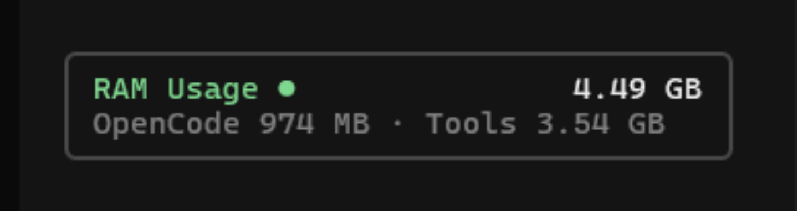
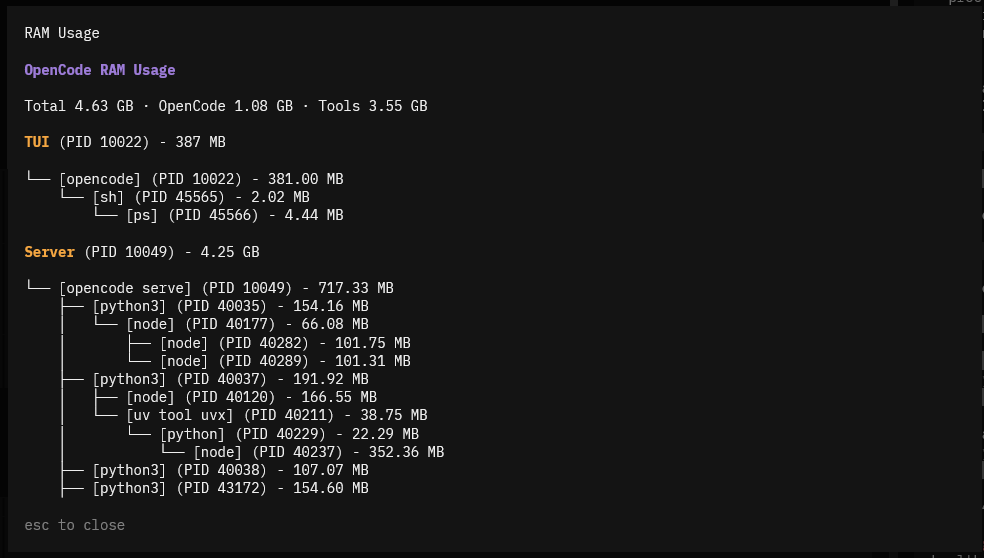
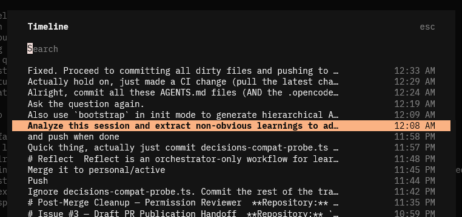
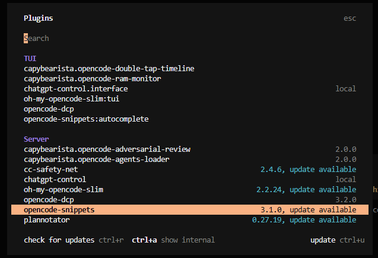

 <p align="center">
  
</p>

<h1 align="center">
  <picture>
    <source srcset=".github/assets/opencode-plugins-dark.svg" media="(prefers-color-scheme: dark)">
    <source srcset=".github/assets/opencode-plugins-light.svg" media="(prefers-color-scheme: light)">
    
  </picture>
</h1>

<p align="center">
  <strong>Small upgrades to how you use OpenCode.</strong>
</p>

<p align="center">
  Independent plugins for code reviews, live RAM monitoring, faster navigation, reusable agent configurations, and more!
</p>

<p align="center">
  <a href="https://www.npmjs.com/~capybearista"></a>
  <a href="https://opencode.ai"></a>
  <a href="https://opensource.org/licenses/MPL-2.0"></a>
  <a href="https://github.com/capybearista/opencode-plugins/actions/workflows/ci.yml"></a>
  <a href="https://deepwiki.com/capyBearista/opencode-plugins"></a>
</p>

<p align="center">
  <a href="#meet-the-plugins">Explore Plugins</a> ·
  <a href="#quick-start-opencode-v2">Quick Start</a> ·
  <a href="#compatibility">Compatibility</a> ·
  <a href="#contributing">Contributing</a>
</p>

---

**No bundle required.** Each plugin is independently published and installable. Pick the ones that improve your workflow.

## Plugins at a Glance

| Plugin | What it does |
| --- | --- |
| [🤺 Adversarial Review](./packages/opencode-adversarial-review/) | Challenge your implementation before shipping. |
| [🐏 RAM Monitor](./packages/opencode-ram-monitor/) | See where OpenCode's memory goes. |
| [⏱️ Double-Tap Timeline](./packages/opencode-double-tap-timeline/) | Open the session timeline with two Escape presses. |
| [🛠️ Agents Loader](./packages/opencode-agents-loader/) | Reuse agents and commands across AI coding tools. |
| [🗣️ Output Styles](./packages/opencode-output-styles/) | **V1 only:** Customize how your agents approach conversations. |
| [💬 Agent Prompt Inheritance](./packages/opencode-agent-prompt-inheritance/) | **V1 only:** Preserve base model instructions when customizing agents. |

## Meet the Plugins

### 🤺 Adversarial Review [[opencode-adversarial-review]](./packages/opencode-adversarial-review/)

<p>
  
  
</p>

**Challenge your code before shipping it.**

Two clean-context reviewers examine your code independently of the conversation that produced it:

- **`/adversarial-review`** — Challenges implementation decisions and looks for reasons not to ship, prioritizing correctness, security, and data-loss risks.
- **`/constructive-review`** — Reviews correctness and provides actionable improvements.

Both reviewers gather their own evidence, support working-tree changes, commits, branches, and pull requests, and produce structured findings.

### 🐏 RAM Monitor [[opencode-ram-monitor]](./packages/opencode-ram-monitor/)

<p>
  
  
</p>

**See where OpenCode's memory goes.**

<table>
  <tr>
    <td width="50%" align="center">
      
      <br /><strong>Full view</strong>
    </td>
    <td width="50%" align="center">
      
      <br /><strong>Minimal view</strong>
    </td>
  </tr>
</table>

<details>
  <summary><strong>More screenshots</strong></summary>
  <br />
  
  <p><em>Detailed process tree</em></p>
</details>

Monitor OpenCode's memory usage directly in the sidebar, including MCP servers, language servers, and terminal processes. Choose between full and minimal layouts, or use `/ram` to inspect the detailed process tree. No additional dependencies required.

### ⏱️ Double-Tap Timeline [[opencode-double-tap-timeline]](./packages/opencode-double-tap-timeline/)

<p>
  
  
</p>

**Navigate your session without reaching for a command.**

Inspired by Claude Code's double-Escape interaction. Double-tap `Esc` to open OpenCode's session timeline instantly, without typing `/timeline` or using the mouse.

Single-Escape behavior remains unchanged, and no additional configuration is required.

<details>
  <summary><strong>See the session timeline</strong></summary>
  <br />
  
  <p><em>OpenCode's Session Timeline</em></p>
</details>

### 🛠️ Agents Loader [[opencode-agents-loader]](./packages/opencode-agents-loader/)

<p>
  
  
</p>

**Keep your agents and commands portable.**

Extend OpenCode's agent and command discovery to the `.agents/` directory convention, allowing configurations to be shared across compatible AI coding tools.

- **Global and project-local:** Discover files in `~/.agents/` and `.agents/`.
- **Native integration:** Managed symlinks expose files to OpenCode without rewriting their contents.
- **Automatic synchronization:** Changes are reconciled while preserving native OpenCode configuration precedence.

## Quick Start (OpenCode V2)

Install only the plugins you want by adding their npm packages to your OpenCode configuration.

OpenCode V2 separates **server plugins** from **TUI plugins**. They use different configuration files.

### 1. Server plugins

Add your selected server plugins to `opencode.json` or `opencode.jsonc`:

```json
{
  "$schema": "https://opencode.ai/config.json",
  "plugins": [
    "@capybearista/opencode-adversarial-review@latest",
    "@capybearista/opencode-agents-loader@latest"
  ]
}
```

**Adversarial Review setup:** The target `commands/` directory must already exist and be writable before enabling the plugin. The plugin installs its two review command files there. See the [package installation guide](./packages/opencode-adversarial-review/#install).

### 2. TUI plugins

Add your selected TUI plugins to your global `cli.json`, typically at `~/.config/opencode/cli.json`:

```json
{
  "$schema": "https://opencode.ai/v2/cli.json",
  "plugins": [
    "@capybearista/opencode-double-tap-timeline@latest",
    "@capybearista/opencode-ram-monitor@latest"
  ]
}
```

> [!IMPORTANT]
> RAM Monitor requires **OpenCode 2.1 or later**. Both TUI plugins belong in `cli.json`, not `opencode.json`.

**That's it!** Keep only the plugins you want, and check their individual READMEs for configuration options, usage examples, and troubleshooting.

## Compatibility

The repository supports both OpenCode V2 and V1, but plugin availability and configuration differ between versions.

| Plugin | OpenCode V2 | OpenCode V1 |
| --- | --- | --- |
| [Adversarial Review](./packages/opencode-adversarial-review/) | `@latest` · `opencode.json(c)` | `@1.0.0` · `opencode.json(c)` |
| [Agents Loader](./packages/opencode-agents-loader/) | `@latest` · `opencode.json(c)` | `@1.0.0` · `opencode.json(c)` |
| [Double-Tap Timeline](./packages/opencode-double-tap-timeline/) | `@latest` · `cli.json` | `@1.0.1` · `tui.json(c)` |
| [RAM Monitor](./packages/opencode-ram-monitor/) | `@latest` · `cli.json` (2.1+) | `@1.1.0` · `opencode.json(c)` and `tui.json(c)` |
| [Agent Prompt Inheritance](./packages/opencode-agent-prompt-inheritance/) | Not yet ported | `@1.0.0` · `opencode.json(c)` |
| [Output Styles](./packages/opencode-output-styles/) | Not planned | `@1.0.1` · `opencode.json(c)` |

**Using OpenCode V1?** See the [V1 Plugin Guide](./docs/v1-plugins.md) for installation, version pinning, and upgrade instructions.

### Updating Plugins

OpenCode V2 provides a built-in TUI plugin manager and CLI commands for checking and installing updates.

**Through the TUI:** Open the plugins dialog from the footer or through the "Open plugins" action to inspect plugin status and manage updates.

<details>
  <summary><strong>View the TUI plugin manager</strong></summary>
  <br />
  
  <p><em>OpenCode's TUI plugin manager</em></p>
</details>

**Through the CLI:**

```bash
# Check for available updates
opencode plugin check

# Update all configured mutable targets
opencode plugin update

# Update a specific plugin
opencode plugin update @capybearista/opencode-ram-monitor
```

Only mutable targets, such as `@latest`, receive updates. Exact version pins remain unchanged.

## Legacy Plugins (OpenCode V1)

These plugins remain available for OpenCode V1 but have not been ported to V2.

### 🗣️ Output Styles [[opencode-output-styles]](./packages/opencode-output-styles/)


**Choose how your agent responds, and keep it that way.**

Switch between persistent response styles without repeating the same instructions throughout a conversation.

Includes built-in `explanatory` and `learning` styles, with support for custom project-local and global styles.

### 💬 Agent Prompt Inheritance [[opencode-agent-prompt-inheritance]](./packages/opencode-agent-prompt-inheritance/)


**Keep base model instructions when customizing agents.**

Custom agent prompts can replace provider-specific system instructions. This plugin allows agents to inherit supported provider prompts while adding their own task-specific guidance.

Supports configurable prompt ordering through agent frontmatter.

## Contributing

Contributions, bug reports, and suggestions are welcome! If you'd like to contribute code, take a look at [CONTRIBUTING.md](./CONTRIBUTING.md) and the [documentation index](./docs/README.md).

### What Should I Build Next?

Every plugin here started because I hit a wall with stock OpenCode and thought *"there's gotta be a better way."*

I usually browse through [Reddit](https://reddit.com/r/opencodecli) and the GitHub Issues section of [OpenCode](https://github.com/anomalyco/opencode), noticing people griping about their workflows. But if you've got a concrete idea and want to put it directly in front of me, I'm all ears :)

<span>&#8611;</span> **Got a brand-new plugin idea?** [Open a plugin proposal](https://github.com/capybearista/opencode-plugins/issues/new?template=new_plugin_proposal.yml).
<br>
<span>&#8611;</span> **Found something broken or have an improvement in mind?** [Open a feature request](https://github.com/capybearista/opencode-plugins/issues/new?template=feature_request.yml).

If these plugins have made your workflow better, consider starring the repository. It helps other OpenCode users discover the project.

### Development

This project is a monorepo managed with **Bun** and **Turborepo**.

For development setup, build and test commands, release conventions, and contribution guidelines, see [CONTRIBUTING.md](./CONTRIBUTING.md).

## Shoutouts

Plugins I've personally used and highly recommend! Some of these are genuinely underrated and have massive potential.

| Name                                                                             | Use case                                                         | Description                                                                                                                                                                        |
| -------------------------------------------------------------------------------- | ---------------------------------------------------------------- | ---------------------------------------------------------------------------------------------------------------------------------------------------------------------------------- |
| [opencode-quota](https://github.com/slkiser/opencode-quota)                      | Keep track of your provider subscriptions _in_ OpenCode          | Token usage and quota tracking for Anthropic, OpenAI, Copilot, and more—reports in terminal with zero context pollution.                                                           |
| [opencode-snippets](https://github.com/JosXa/opencode-snippets)                  | Expand `#tags` into text anywhere, instantly                     | Hashtag-based snippet expansion. Just type `#name` to inject pre-defined code blocks, configs, or prompts inline. You can even put them in commands.                               |
| [opencode-dynamic-context-pruning](https://github.com/Opencode-DCP/opencode-dynamic-context-pruning) | Caps token waste from stale context                              | Context-aware compression intelligently prunes old tool outputs to keep context lean and reduce token burn.                                                                        |
| [cc-safety-net](https://github.com/kenryu42/claude-code-safety-net)              | Prevents dangerous commands like `rm -rf` and `git reset --hard` | Intercepts destructive git and filesystem commands before they execute, giving you a chance to abort before your agent deletes your entire project.                                |
| [opencode-agent-identity](https://github.com/gotgenes/opencode-agent-identity)   | Distinguish which sub-agent said what in multi-agent sessions    | Per-message attribution so each agent knows its role and which message came from which source.                                                                                     |

## License

Distributed under the [Mozilla Public License 2.0](./LICENSE.txt).

This project is independently developed and maintained. It is **not affiliated with the OpenCode team**.

Made for the love of the game ¯\\_(ツ)_/¯
