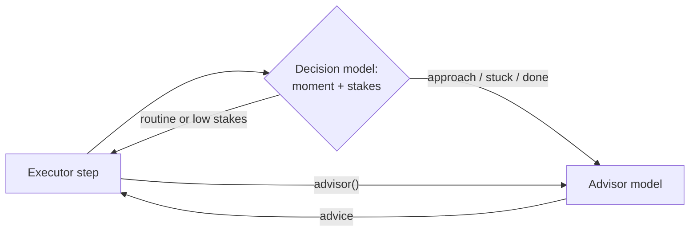

# opencode-auto-advisor

<p align="center">A Claude Code-style Advisor for OpenCode: a stronger model reviews your agent's work when it asks, or automatically at the moments that matter.</p>
<p align="center">
  <a href="https://www.npmjs.com/package/@capybearista/opencode-auto-advisor"></a>
  <a href="https://www.npmjs.com/package/@capybearista/opencode-auto-advisor"></a>
  <a href="https://opencode.ai"></a>
  <a href="https://opensource.org/licenses/MPL-2.0"></a>
</p>

---

## Why?

> Most turns of a coding task are routine, but a few decide the outcome: committing to an approach, getting stuck on the same failure, declaring the work done. Claude Code's [Advisor](https://code.claude.com/docs/en/advisor) lets the agent consult a stronger model at those moments. This plugin brings the same idea to OpenCode, and adds a way to catch those moments even when the agent doesn't ask.

## Philosophy: Extending OpenCode

OpenCode is designed to be highly extensible. This plugin uses only public V2 plugin APIs: a tool, the `context` hook, host-resolved [Decision models](https://opencode.ai/docs/en/zen/#jev), stateless generation, and session instruction entries. It never edits the system prompt, so it doesn't break the provider's prompt cache.

### Architecture



Two paths reach the same stateless Advisor. The agent can call the `advisor()` tool itself. In `active` mode, a fast Decision model also reads each step, and the plugin consults the Advisor when the agent is at one of Claude Code's three moments and a wrong next step would cost something.

## Features

- **Explicit `advisor()` tool**: zero arguments. The Advisor reads the agent's system prompt, tool list and transcript, and returns concise, actionable advice as the tool result.
- **Automatic reviews (opt-in)**: a Decision model classifies each step as `approach`, `stuck`, `done` or `routine`, and scores how costly a mistake would be (0–4). The plugin consults the Advisor when both pass your thresholds.
- **Advice on the same step**: the review reaches the waiting request immediately, and stays in the session as an instruction entry until a newer review replaces it.
- **Cache-safe**: no system-prompt edits. Only the newest message of a request changes.
- **Observe mode**: run the Decision model without consulting, and log what it would have done, to tune the thresholds.
- **TUI status**: "Advisor reviewing…" in the prompt footer, and the latest review above the composer.

## Install

### OpenCode V2

Requires OpenCode **2.2.0** or later.

This plugin has a Server component + TUI component.

Add one entry under the `"plugins"` key in `opencode.json(c)`:

```json
{
  "plugins": ["@capybearista/opencode-auto-advisor@latest"]
}
```

The TUI half loads automatically, so `cli.json` needs no entry.

### OpenCode V1

Not available. The plugin depends on OpenCode 2.2.0's Decision and instruction-entry APIs.

### Uninstall

Remove the entry from `"plugins"` in `opencode.json(c)`. Optionally delete `~/.config/opencode/auto-advisor.json` and the telemetry folder `~/.local/share/opencode/auto-advisor/`.

## Usage

- **Ask for a review**: the agent sees the `advisor()` tool and its guidance (consult after orienting, when stuck, before declaring done). You can also say "consult the advisor before you continue".
- **Turn on automatic reviews**: set `routing.mode` to `observe` first, watch the telemetry for a while, then switch to `active`.
- Automatic reviews run in top-level sessions only. Subagent sessions don't get the tool or automatic reviews.
- Automatic reviews are capped per user turn (`routing.maxConsultationsPerTurn`, default 2). Explicit `advisor()` calls don't count against the cap.

## Configuration

Global, optional, strict JSON at `~/.config/opencode/auto-advisor.json` (or `$OPENCODE_CONFIG_DIR/auto-advisor.json`, or `$XDG_CONFIG_HOME/opencode/auto-advisor.json`). A missing file means all defaults, an omitted key means its default, and an invalid file turns automatic reviews off (the explicit tool keeps working). Changes apply on the next step without a restart.

```json
{
  "advisor": { "model": "openai/gpt-6" },
  "routing": { "mode": "active" }
}
```

| Key | Default | Description |
| :--- | :--- | :--- |
| `advisor.model` | `"inherit"` | `"provider/model"` of the Advisor, or `"inherit"` to use the agent's own model. |
| `advisor.timeoutMs` | `300000` | Soft deadline for one consult. An automatic consult that runs out fails open; an explicit one returns an error. |
| `routing.mode` | `"off"` | `off`, `observe` (Decision model only, logged), or `active` (consults and delivers). |
| `routing.models` | `["opencode/jev-1.13-free"]` | Ordered decision models, 1–8 `"provider/model"` refs. On an availability or auth failure, the plugin tries the next one. |
| `routing.momentThreshold` | `0.7` | Minimum probability that the step is not routine. |
| `routing.consequenceThreshold` | `1.5` | Minimum stakes score (0 trivial … 4 critical), compared unrounded. |
| `routing.maxConsultationsPerTurn` | `2` | Automatic consults per user turn. |

## Privacy and cost

- **Decision provider**: in `observe` and `active`, each step's latest request, recent tool calls and truncated results (no system prompt, no tool definitions) go to the configured decision model. The default, `opencode/jev-1.13-free`, is a limited-time free model on OpenCode Zen, built by TypeSafe AI. Check Zen's data-retention terms for it before using it with sensitive code.
- **Advisor**: each consult sends the agent's full transcript (up to the model's context) to the Advisor model, uncached. It's billed at that model's rates.
- **Latency**: in `active`, every step waits for one Decision call (about 0.1–0.4 s on Zen after a cold start). A consult pauses the agent until the Advisor answers.
- **Cache**: installing the plugin adds the `advisor` tool, which costs one prompt-cache miss on the tools block. After that, reviews only add to the end of a request.
- **Telemetry**: one JSON line per routing decision in `~/.local/share/opencode/auto-advisor/telemetry.jsonl` (capped at 5 MB, one rotation), with models, answers, verdicts and timings. Never transcript or advice text.

## Troubleshooting

- **Nothing happens automatically**: `routing.mode` defaults to `off`. Check `telemetry.jsonl` for the verdicts: `routine` and `low-consequence` mean the thresholds held the review back, and `no-decision` means no configured decision model answered.
- **"Advisor unavailable" in the footer**: the consult failed or timed out. The agent carried on without advice.
- **Your config is ignored**: an invalid file switches automatic reviews off. Fix the value named in the error; unknown keys are rejected.
- **Observe mode logs fewer lines than steps**: while one Decision call is still running, later steps in the same session are skipped rather than queued.

## Contributing

This package lives in the `opencode-plugins` monorepo. See the [contribution guidelines](../../CONTRIBUTING.md) for setup, the full check suite, and releases, and open or find an issue before a pull request.

From this directory, `bun test` runs the package tests and `bun run smoke` checks the built package. To try a change in your own OpenCode, see [Testing in OpenCode](../../CONTRIBUTING.md#testing-in-opencode).

## License

[MPL-2.0](./LICENSE.txt)
