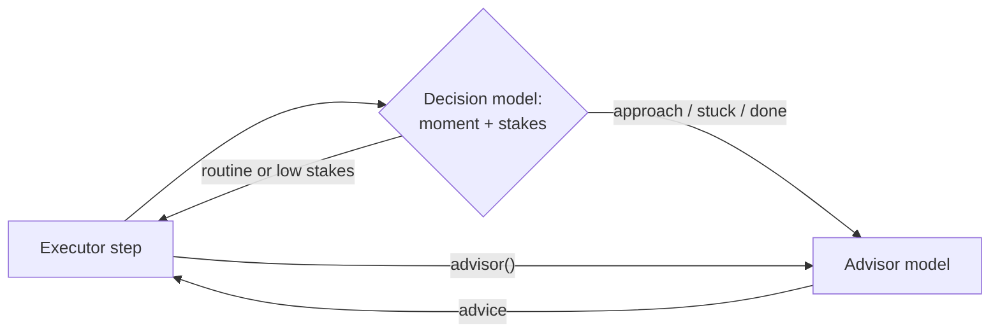

# opencode-auto-advisor

<p align="center">A Claude Code-style Advisor for OpenCode: a stronger model reviews your agent's work when it asks, or automatically at the moments that matter.</p>
<p align="center">
  <a href="https://www.npmjs.com/package/@capybearista/opencode-auto-advisor"></a>
  <a href="https://www.npmjs.com/package/@capybearista/opencode-auto-advisor"></a>
  <a href="https://opencode.ai"></a>
  <a href="https://opensource.org/licenses/MPL-2.0"></a>
</p>

---

## Why?

> Most turns of a coding task are routine, but a few decide the outcome: committing to an approach, getting stuck on the same failure, declaring the work done. Claude Code's [Advisor](https://code.claude.com/docs/en/advisor) lets the agent consult a stronger model at those moments. This plugin brings the same idea to OpenCode, and adds a way to catch those moments even when the agent doesn't ask.

## Philosophy: Extending OpenCode

OpenCode is designed to be highly extensible. This plugin uses only public V2 plugin APIs: a tool, the `context` hook, host-resolved [Decision models](https://opencode.ai/docs/en/zen/#jev), stateless generation, and session instruction entries. It never edits the system prompt, so it doesn't break the provider's prompt cache.

### Architecture



Two paths reach the same stateless Advisor. The agent can call the `advisor()` tool itself. In `active` mode, a fast Decision model also reads each step, and the plugin consults the Advisor when the agent is at one of Claude Code's three moments and a wrong next step would cost something.

## Features

- **Explicit `advisor()` tool**: zero arguments. The Advisor reads the agent's system prompt, tool list and transcript, and returns concise, actionable advice as the tool result.
- **Automatic reviews (on by default)**: a Decision model classifies each step as `approach`, `stuck`, `done` or `routine`, and scores how costly a mistake would be (0–4). The plugin consults the Advisor when both pass your thresholds.
- **Advice on the same step**: the review reaches the waiting request immediately, and stays in the session as an instruction entry until a newer review replaces it.
- **Cache-safe**: no system-prompt edits. Only the newest message of a request changes.
- **Observe mode**: run the Decision model without consulting, and log what it would have done, to tune the thresholds.
- **TUI**: "Advisor reviewing…" in the prompt footer, and a one-line Advisor status at the bottom of the session sidebar. Click it, or run `/advisor-review` (also in the command palette), to read the latest review in a scrollable panel: rendered markdown, its moment, model, duration and time.

## Install

### OpenCode V2

Requires OpenCode **2.2.5** or later.

This plugin has a Server component + TUI component.

Add one entry under the `"plugins"` key in `opencode.json(c)`:

```json
{
  "plugins": ["@capybearista/opencode-auto-advisor@latest"]
}
```

The TUI half loads automatically, so `cli.json` needs no entry.

### OpenCode V1

Not available. The plugin depends on OpenCode 2.2's Decision and instruction-entry APIs, and on the 2.2.5 host text it compacts.

### Uninstall

Remove the entry from `"plugins"` in `opencode.json(c)`. Optionally delete `~/.config/opencode/auto-advisor.json` and the telemetry folder `~/.local/share/opencode/auto-advisor/`.

## Usage

- **Ask for a review**: the agent sees the `advisor()` tool and its guidance: consult after orienting and before substantive work, when stuck or changing approach, and before declaring done (after saving the work). An automatic review counts as a consultation already made. You can also say "consult the advisor before you continue".
- **Automatic reviews are on by default** (`routing.mode` `active`). Without `advisor.model`, they consult the agent's own model and are billed at its rates; set `advisor.model`, or set `routing.mode` to `observe` or `off`, if that's not what you want.
- Automatic reviews run in top-level sessions only. Subagent sessions don't get the tool or automatic reviews.
- Automatic reviews are limited to two per user turn (`routing.maxConsultationsPerTurn`) and to one per 10 agent steps across the session (`routing.minStepsBetweenConsultations`). The step count carries over to the next turn, and a retried step doesn't count. Explicit `advisor()` calls ignore both limits.

## Configuration

Global, optional, strict JSON at `~/.config/opencode/auto-advisor.json` (or `$OPENCODE_CONFIG_DIR/auto-advisor.json`, or `$XDG_CONFIG_HOME/opencode/auto-advisor.json`). A missing file means all defaults, an omitted key means its default, and an invalid file turns automatic reviews off and makes the `advisor()` tool return the error. Changes apply on the next step without a restart.

```json
{
  "advisor": { "model": "openai/gpt-6" },
  "routing": { "mode": "active" }
}
```

| Key | Default | Description |
| :--- | :--- | :--- |
| `advisor.model` | `"inherit"` | `"provider/model"` of the Advisor, optionally with `#variant` for its reasoning level (`"openai/gpt-6#high"`). Without a variant, the provider's default applies. `"inherit"` uses the agent's own model and variant. A list of 1–8 entries is a fallback chain, tried in order: an unreachable model, an exhausted quota, an overload, a missing model or a request the model rejects (such as one over its context window) moves to the next at once. A content filter or an invalid `#variant` stops the chain. A rejection the provider reports without an HTTP status (mid-stream, for example) moves on too. A model that was rate-limited or overloaded, or that ran out the plugin's own deadline, is skipped for 60 s. Each model gets a transcript sized to its own window. Worst cases: a refused connection costs about 12 s before the next model (OpenCode retries it), and a provider that accepts the connection and then goes silent costs up to OpenCode's `headerTimeout` (5 min) or `chunkTimeout` (15 min) on every consult; lower those in that provider's settings, or set `advisor.timeoutMs`. |
| `advisor.timeoutMs` | `-1` | One deadline for the whole `advisor.model` chain, or `-1` for none. With none, a model that is still reasoning is never cut off; OpenCode's own provider timeouts (`headerTimeout`, 5 min without a response; `chunkTimeout`, 15 min without any data) end a silent one, and the chain moves on. A consult that runs out fails open; an explicit one returns an error. Esc (interrupt) stops the wait at once; the provider request itself runs on, because OpenCode's plugin API can't cancel it. |
| `advisor.compactContext` | `true` | Replaces OpenCode's Code Mode tool catalog, MCP server instructions and skill catalog with `[context-omitted: …]` markers in the Advisor's copy of the context. Your rules (AGENTS.md) and the conversation stay. The agent's own context is never changed. Incremental notices about tools, MCP servers or skills added mid-session are kept. `false` sends everything. |
| `advisor.maxTokens` | `64000` | Approximate ceiling on the transcript sent per consult, at least `1000` (the tool-name list is never trimmed). The Advisor model's context window lowers it further (75% of the window). Over budget, older turns in the middle are left out; the system prompt, the first request and the newest steps stay. Counted at 3 characters per token, so the real token count is usually lower. |
| `routing.mode` | `"active"` | `off`, `observe` (Decision model only, logged), or `active` (consults and delivers). |
| `routing.models` | `["opencode/jev-1.13-free"]` | Ordered decision models, 1–8 `"provider/model[#variant]"` refs. On an availability or auth failure, or a request the model rejects (such as one over its context window), the plugin tries the next one, so a small, fast model can go first. Each model gets 5 s, the whole chain 10 s. |
| `routing.momentThreshold` | `0.7` | Minimum probability that the step is not routine. |
| `routing.consequenceThreshold` | `1.5` | Minimum stakes score (0 trivial … 4 critical), compared unrounded. |
| `routing.maxConsultationsPerTurn` | `2` | Automatic consults per user turn. |
| `routing.minStepsBetweenConsultations` | `10` | Agent steps after an automatic consult starts (whatever its outcome) before another may start, counted across turns. `0` turns the cooldown off. |
| `routing.requests` | `3` | How many of your latest requests the Decision model sees, oldest first, from `1` to `20`. Subagent results and other notices are never counted as requests. |
| `routing.requestMaxChars` | `20000` | Characters kept from **each** request sent to the decision model (its start), from `100`; `-1` sends them whole. It caps each request, not the total: the Decision input is up to `routing.requests` × this cap, plus about 12,000 characters of recent steps (about 72,000 with the defaults). The default `opencode/jev-1.13-free` has a 64k-token window, so raising the cap or `routing.requests` can overflow it; the step then falls through to the next model in `routing.models`, or gets no decision. Sizing to each model's window is planned. |
| `tui.sidebar` | `true` | Shows the Advisor status at the bottom of the session sidebar. `false` hides it; `/advisor-review` still opens the review. |

## Privacy and cost

- **Decision provider**: in `observe` and `active`, each step's last `routing.requests` user requests (up to 20,000 characters each by default; see `routing.requestMaxChars`), recent tool calls and truncated results (no system prompt, no tool definitions) go to the configured decision model. The default, `opencode/jev-1.13-free`, is a limited-time free model on OpenCode Zen, built by TypeSafe AI. Check Zen's data-retention terms for it before using it with sensitive code.
- **Advisor**: automatic reviews are on by default and, without `advisor.model`, use the agent's own model. Each consult sends the agent's transcript (system prompt with OpenCode's catalogs left out when `advisor.compactContext` is on, up to `advisor.maxTokens`) to the Advisor model, uncached. It's billed at that model's rates.
- **Latency**: in `active`, every step waits for one Decision call (about 0.1–0.4 s on Zen after a cold start), except while a limit blocks consults: then the call runs in the background, as in `observe`. A consult pauses the agent until the Advisor answers.
- **Cache**: installing the plugin adds the `advisor` tool, which costs one prompt-cache miss on the tools block. After that, reviews only add to the end of a request.
- **Telemetry**: one JSON line per routing decision in `~/.local/share/opencode/auto-advisor/telemetry.jsonl` (capped at 5 MB, one rotation), with models, answers, verdicts and timings. It also keeps the step's Decision input (its last 32,000 characters: your recent requests, tool calls and truncated results) and the id of the newest message, all on your machine and readable only by you. Never the Advisor's transcript or advice text. At the 32,000-character maximum, a 5 MB file holds about 150 steps, so long sessions keep only their latest steps.

## Troubleshooting

- **Judging the verdicts**: from a checkout of this repo, with OpenCode running, `bun run timeline <sessionID> [--out file.html]` in `packages/opencode-auto-advisor` writes one page per session: each routing decision with its moment probabilities, consequence, limit and Advisor outcome, and, expanded, the messages since the previous step and the exact Decision input.
- **Nothing happens automatically**: check `telemetry.jsonl` for the verdicts. `routine` and `low-consequence` mean the thresholds held the review back, `blocked` means the cooldown or the per-turn limit did (the `blocked` field says which; a step both block is logged as `cooldown`), and `no-decision` means no configured decision model answered.
- **"Advisor unavailable" in the footer or sidebar**: every Advisor model failed or the deadline ran out. The agent carried on without advice. `advisor.attempts` in `telemetry.jsonl` lists each model's outcome.
- **No Advisor in the sidebar**: OpenCode shows the sidebar only in top-level sessions, and only on terminals wider than 120 columns unless you open it. While the review panel is open, it takes the sidebar's place. `/advisor-review` works either way.
- **The review panel shows no model or duration**: they are kept in memory, so a review delivered before OpenCode restarted shows only its moment and text.
- **Your config is ignored**: an invalid file switches automatic reviews off, and `advisor()` returns `invalid config: …` naming the bad value; unknown keys are rejected. With a local checkout, run `bun run build` after pulling: OpenCode loads `dist/`, and an older build rejects newer keys.
- **Observe mode logs fewer lines than steps**: while one Decision call is still running, later steps in the same session are skipped rather than queued. The same holds in `active` while a limit blocks consults.

## Contributing

This package lives in the `opencode-plugins` monorepo. See the [contribution guidelines](../../CONTRIBUTING.md) for setup, the full check suite, and releases, and open or find an issue before a pull request.

From this directory, `bun test` runs the package tests and `bun run smoke` checks the built package. To try a change in your own OpenCode, see [Testing in OpenCode](../../CONTRIBUTING.md#testing-in-opencode).

## License

[MPL-2.0](./LICENSE.txt)
