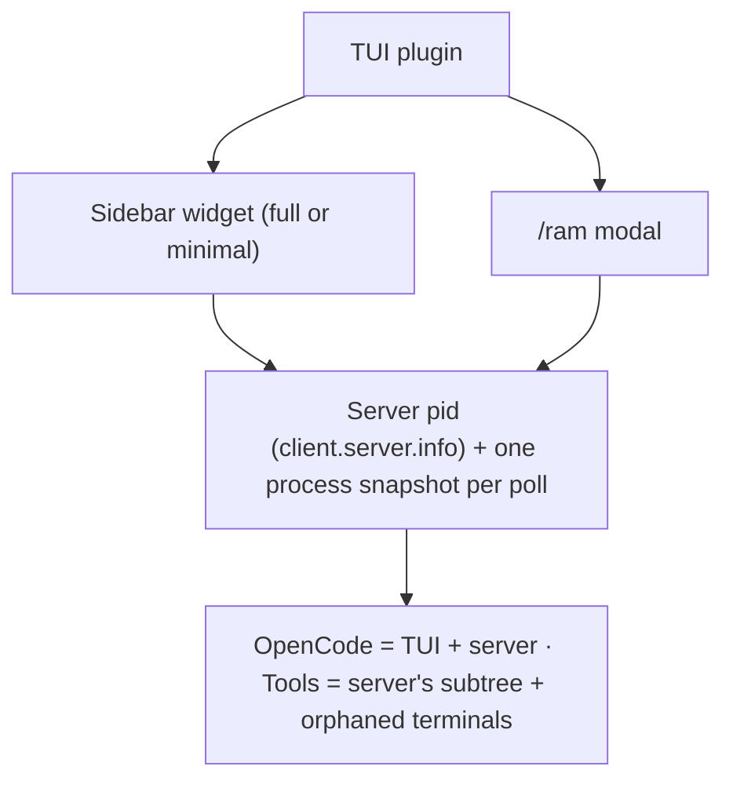

# opencode-ram-monitor

<p align="center">Zero-dependency RAM monitoring for OpenCode sessions</p>
<p align="center">
  <a href="https://www.npmjs.com/package/@capybearista/opencode-ram-monitor"></a>
  <a href="https://www.npmjs.com/package/@capybearista/opencode-ram-monitor"></a>
  <a href="https://opencode.ai"></a>
  <a href="https://opensource.org/licenses/MPL-2.0"></a>
</p>

[](https://github.com/capyBearista/opencode-plugins/tree/main/packages/opencode-ram-monitor)

---

## Why?

> This plugin gives developers real-time, zero-dependency insight into how much memory OpenCode is using. The sidebar shows the total, split into OpenCode itself (this TUI and the shared server) and the tools the server runs (MCP servers, language servers, shell commands, terminals). The `/ram` command (and clicking the widget) opens the full process tree in a pop-up.

## Philosophy: Extending OpenCode

OpenCode V2 runs one shared background server per user. Every TUI connects to it, and the server owns sessions and tool execution. Memory is shared rather than per-session, so this plugin reports it by role:

- **OpenCode**: this TUI (plus its own helper processes) and the server it is connected to.
- **Tools**: everything the server runs, plus terminal panes (`opencode-pty`) that outlived a server restart.

The plugin asks OpenCode which server this TUI talks to and only trusts that answer when the local process table confirms it. It runs locally, needs no dependencies, and falls back to this TUI's own memory if the server or the process list cannot be read.

### Architecture



## Features

- **Real-time sidebar widget**: shows the total, then OpenCode vs. tools, in a compact card.
- **Minimal layout**: one borderless line, `RAM ● 4.88 GB (tools 3.39 GB)`, for a quieter sidebar.
- **`/ram` command**: opens the TUI, server, and terminal process trees in a pop-up (also opened by clicking the widget).
- **Cross-platform**: uses native commands (`ps` on Unix, `wmic` on Windows) for lightweight zero-dependency metrics.
- **Configurable**: layout and polling interval via plugin `options`, applied live when `cli.json` changes.

## Install

### OpenCode V2

Requires OpenCode 2.1 or later. This is a TUI-only plugin: add it under the `"plugins"` key in `cli.json` (your global OpenCode config directory, usually `~/.config/opencode/cli.json`):

```json
{
  "plugins": ["@capybearista/opencode-ram-monitor@latest"]
}
```

> [!IMPORTANT]
> Do not add it to `opencode.json(c)`. Since 2.1.0 the package has no server entry, and OpenCode reports "Plugin entrypoint not found" for it there. If you are upgrading from 2.0.x, remove that entry.

### OpenCode V1

Add it under the `"plugin"` key in `opencode.json(c)`:

```json
{
  "plugin": ["@capybearista/opencode-ram-monitor@1.1.0"]
}
```

**AND**

Add it under the `"plugin"` key in `tui.json(c)`:

```json
{
  "plugin": ["@capybearista/opencode-ram-monitor@1.1.0"]
}
```

See the [V1 plugin guide](../../docs/v1-plugins.md) for details.

### Uninstall

Remove the plugin from `"plugin(s)"` from the respective config files they were added to. 

## Usage

Once installed, the RAM monitor appears in the TUI sidebar of every session:

```text
╭───────────────────────────────────╮
│ RAM Usage ●              4.88 GB  │
│ OpenCode 1.49 GB · Tools 3.39 GB  │
╰───────────────────────────────────╯
```

- **Header**: total memory; the dot flips on every refresh.
- **OpenCode**: this TUI plus the shared server.
- **Tools**: MCP servers, language servers, shell commands, and terminal panes the server runs.

Type `/ram` or click the widget for the full process tree; `esc` closes it.

## Configuration

Pass options in the plugin's `cli.json` entry, using the object form:

```json
{
  "plugins": [
    {
      "package": "@capybearista/opencode-ram-monitor@latest",
      "options": { "layout": "minimal", "refreshIntervalMs": 2000 }
    }
  ]
}
```

> [!WARNING]
> Use the object form above. The V1 tuple form (`["@capybearista/opencode-ram-monitor", { ... }]`) is not valid in V2's `cli.json`, and one invalid entry makes OpenCode ignore the whole file, including your theme, keybinds, and every other plugin.

| Option | Type | Default | Description |
| :--- | :--- | :--- | :--- |
| `layout` | `"full"` \| `"minimal"` | `"full"` | `full` is the bordered two-row card. `minimal` is one borderless line: `RAM ● 4.88 GB (tools 3.39 GB)`. |
| `refreshIntervalMs` | `number` | `5000` | Polling interval in milliseconds. Numeric strings are accepted. Values are clamped between `1000` and `60000`. |

Invalid values fall back to the default and show a warning: as footer text in the full layout, as a warning color in the minimal layout, and listed at the top of the `/ram` pop-up.

OpenCode re-applies a plugin's options when `cli.json` changes, so edits take effect without a restart. Options are only read from `cli.json`; the 2.0.x `experimental.ramMonitor` config-file key is no longer supported.

## Troubleshooting

- **Widget missing from sidebar**: Check the entry is in the global `cli.json` `plugins` list. OpenCode does not read project-level `cli.json` files. The sidebar also hides for subagent sessions and on narrow terminals (toggle it with the `session.sidebar.toggle` command).
- **"server not visible"**: The plugin could not confirm which server this TUI uses, so it shows only this TUI's memory. This is expected when the TUI is connected to a remote server with `--server`, because that server's processes are on another machine.
- **"process list unavailable"**: `ps` (or `wmic` on Windows) could not be run, so only this TUI's own memory is shown. Ensure standard process utilities are installed.
- **Windows shows only the TUI's memory**: On Windows the plugin reads the process list with `wmic`, which Microsoft has deprecated and newer Windows 11 releases no longer install by default. Without it, the widget falls back to this TUI's own memory with the "process list unavailable" notice. Where Windows still offers WMIC as an optional feature, enabling it restores the full numbers. WSL is unaffected; it uses the Linux path.
- **Other OpenCode windows are not counted**: Each TUI counts itself plus the shared server and its tools. Other TUI windows connected to the same server are not included.
- **Tools look high**: Tools include everything the server starts: MCP servers, language servers, shell commands, and terminal panes. Open `/ram` to see which processes are responsible.
- **Options did not apply**: Make sure the entry uses the object form (see [Configuration](#configuration)) and lives in the global `cli.json`.

## Development Notes

### Debug logging

Debug logging is disabled by default. To enable diagnostic logs during development:

```bash
OPENCODE_RAM_MONITOR_DEBUG=1 opencode
```

When enabled, the plugin appends structured JSON log lines to `.opencode-ram-monitor.log` in the current working directory.

## Contributing

This package lives in the `opencode-plugins` monorepo.

See the [contribution guidelines](../../CONTRIBUTING.md) before opening a pull request.

- From the monorepo root, run `bun run build` before artifact checks, then `bun run typecheck`,`bun run lint`, and the canonical `bun run test` Turbo pipeline. Do not use bare root `bun test` as the workspace check.
- For a focused run, `bun test` is supported from this package directory. `bun run smoke` builds the package and loads it through OpenCode's own entry resolver.
- `bun run check` writes Biome changes; use it only when formatting changes are intended.
- Prefer small, direct changes.

Please open an issue or check for existing ones before creating a pull request.

## License

[MPL-2.0](./LICENSE.txt)
